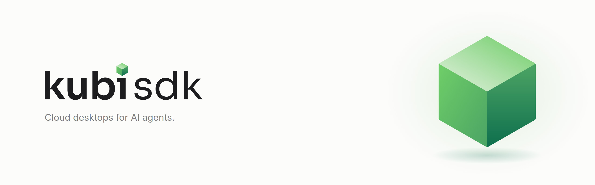
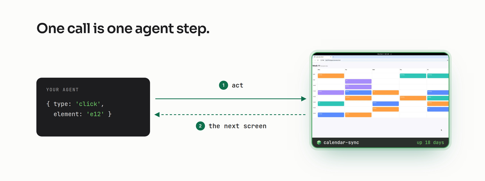
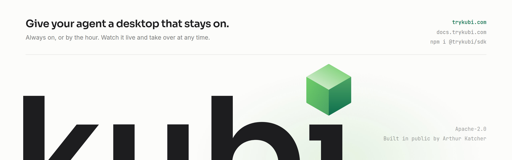

<p align="center">
  <a href="https://trykubi.com"></a>
</p>

<p align="center">
  <a href="https://www.npmjs.com/package/@trykubi/sdk"></a>
  <a href="https://www.npmjs.com/package/@trykubi/sdk"></a>
  <a href="https://www.npmjs.com/package/@trykubi/sdk"></a>
  <a href="LICENSE"></a>
  
</p>

<p align="center">
  <a href="https://trykubi.com">Website</a> ·
  <a href="https://docs.trykubi.com">Docs</a> ·
  <a href="https://docs.trykubi.com/sdk/typescript">SDK reference</a> ·
  <a href="https://docs.trykubi.com/connect-your-agent">MCP server</a> ·
  <a href="https://console.trykubi.com">Console</a>
</p>

# kubi-sdk

The TypeScript SDK for [Kubi](https://trykubi.com): cloud Linux desktops ("screens") for AI agents. Apache-2.0.
Docs: [docs.trykubi.com](https://docs.trykubi.com).

A screen is a real Linux desktop that stays on: its browser keeps its logins, its files and open windows are where
your agent left them, and it keeps running with your laptop closed. Your agent sees it, clicks and types on it, reads
its accessibility tree, runs commands and moves files, and you can watch it live and take over at any time. This
package is the typed client for all of it.

- **Persistent or disposable.** Keep a screen on for good, or make a disposable one for a run, with an end time if you want.
- **One call is one agent step.** Act, and the reply carries the screen after it settles, ready for the next decision.
- **Pixels or elements.** Click by coordinates, or by an element from the accessibility tree, and check what changed.
- **Safe to retry.** A click is never sent twice by a retry, and a stale screenshot is refused instead of acted on.
- **People in the loop.** A live-view link, Take control in the dashboard, and a record of every call.
- **Small and plain.** One dependency (`openapi-fetch`), ESM, full types from the public spec, no install scripts, no telemetry.

## Install

```bash
npm install @trykubi/sdk
```

The package runs on Node 20 or newer and ships as an ES module with its type declarations. Create an API key in the
[console](https://console.trykubi.com) under **API keys** and put it in the environment:

```bash
export KUBI_API_KEY=kubi_...
```

New to Kubi? The [quickstart](https://docs.trykubi.com/quickstart) goes from sign-up to your agent's first click in
about five minutes. Prefer no code? Add the hosted MCP server to Claude Code, Codex, Cursor or VS Code:
[Connect your agent](https://docs.trykubi.com/connect-your-agent).

## Quickstart

```ts
import { Kubi } from '@trykubi/sdk'

const kubi = new Kubi() // KUBI_API_KEY from the environment
const screen = kubi.screen('scr_...')
const shot = await screen.screenshot()
await screen.act([{ type: 'click', x: 640, y: 360 }], { screenshot_id: shot.screenshot_id, screenshot: 'after' })

const op = await kubi.screens.create({ name: 'worker' })
await kubi.operations.wait(op.id) // long polls; throws OperationFailedError if it fails
```

## Examples

<p align="center">
  
</p>

### Look, then act

Pass the `screenshot_id` your model looked at, and the API refuses the action if the screen changed since (a person
typing included). With `screenshot: 'after'` the reply carries the next screen, so the loop makes one call per step.

```ts
const screen = kubi.screen('scr_...')
let shot = await screen.screenshot() // shot.data is the image, base64

for (let step = 0; step < 20; step++) {
  const action = { type: 'click' as const, x: 640, y: 360 } // what your model decided from shot.data
  const r = await screen.act([action], { screenshot_id: shot.screenshot_id, screenshot: 'after' })
  if (r.status !== 'completed') break // a batch stops at its first failure
  if (r.screenshot) shot = r.screenshot
}
```

`act` takes 1 to 20 actions in one batch: click, move, drag, scroll, type, key, wait, settle, zoom and more. Each has
its own method too (`click`, `type`, `press`, `scroll`, `drag`, `move`). How each model's computer-use actions map to
these: [Claude, OpenAI and Gemini](https://docs.trykubi.com/guides/models).

### Act by element

Read the accessibility tree, act on an element by its id instead of guessing pixels, and check the result in the
same call.

```ts
const tree = await screen.tree({ query: 'Save' }) // tree.text is the same tree as rows for a model
const save = tree.elements.find((e) => e.role === 'push button' && e.id)

if (save?.id) {
  const r = await screen.act([{ type: 'click', element: save.id }], {
    screenshot_id: tree.screenshot_id,
    expect: { conditions: [{ window_title: 'Saved' }], timeout_ms: 3000 },
    tree: 'after', // the next tree, its ids ready for the next call
  })
  console.log(r.expectation?.result) // satisfied, unsatisfied or unknown; unknown is never success
}
```

`set_value` fills a field and `invoke` runs an element's own action (it reaches items in a closed menu), both
without the pointer; `focus` brings a window to the front.

### Commands and files

```ts
await screen.files.upload('/home/user/data.csv', 'id,total\n1,42\n')

const run = await screen.exec({ command: './build-report.sh data.csv', cwd: '/home/user', timeout_s: 3600 })
const done = run.status === 'running' ? await screen.waitForExec(run.id) : run // reading never reruns it
console.log(done.exit_code, done.stdout)

const pdf = await screen.files.download('/home/user/report.pdf') // Uint8Array
```

Short commands answer finished; long ones answer `running` and `waitForExec` follows them. More:
[Commands and files](https://docs.trykubi.com/guides/commands-and-files).

### Watch it, or hand it to a person

```ts
const { url } = await screen.viewerLink() // a live view: open within 60 s, single use; agents' links are view-only

for await (const row of screen.followHistory()) console.log(row.at, row.summary) // every call, as it happens
```

From the dashboard a person can press **Take control** and use the desktop themselves; the agent's calls are refused
until they press **Release** or 5 minutes pass with no input. More: [People and agents](https://docs.trykubi.com/concepts/people-and-agents).

### Snapshots, templates and disposable screens

```ts
const snap = await screen.snapshots.create({ name: 'before-upgrade' }) // an undo point, restored with screen.reset()
await kubi.operations.wait(snap.id)

const saved = await kubi.operations.wait((await kubi.templates.create({ screen_id: screen.id, name: 'logged-in-crm' })).id)
const op = await kubi.screens.create({ kind: 'disposable', template_id: saved.template_id ?? undefined, ends_in_s: 3600 })
const { screen_id } = await kubi.operations.wait(op.id) // a fresh copy for one run, deleted after an hour
```

Power, create, delete, snapshots and templates answer with an operation; `operations.wait` follows it to the end.
More: [Screens](https://docs.trykubi.com/concepts/screens).

### Errors

```ts
import { KubiError } from '@trykubi/sdk'

try {
  await screen.click({ x: 640, y: 360, screenshot_id: shot.screenshot_id })
} catch (e) {
  if (e instanceof KubiError && e.code === 'STALE_OBSERVATION') {
    // the screen changed since that screenshot: look again, never repeat the click blind
  } else throw e
}
```

Every error code, what it means and what to do: [Errors](https://docs.trykubi.com/errors).

## Options

| Option | Default | What it does |
|---|---|---|
| `apiKey` | `KUBI_API_KEY` | The API key every call sends |
| `baseUrl` | `https://api.trykubi.com/v1` | Where the API is |
| `run` | `KUBI_RUN`, `CLAUDE_CODE_SESSION_ID` or one id | Labels every call with `Kubi-Run` |
| `maxRetries` | `2` | Retries of calls the API marks `retryable` |
| `fetch` | the global `fetch` | Your own `fetch`, for proxies or tests |

```ts
const kubi = new Kubi({ apiKey: process.env.MY_KUBI_KEY, run: 'nightly-eval-42' })
```

## Shape

- `kubi.screens` (list, all, create, get), `kubi.templates`, `kubi.operations` (get, wait), `kubi.secrets`,
  `kubi.me()`, `kubi.openApi()`, and `kubi.raw`, the typed client for every path in the spec.
- `kubi.screen(id)`: get, update, delete, start, stop, restart, convert, reset, `snapshots`, `operations`;
  screenshot, screenshotImage, zoom, tree; act and the single actions (click, type, press, scroll, drag, move);
  exec, `execs` (get, kill), waitForExec; `files` (upload, download, list, all); `clipboard` (get, set);
  viewerLink; `history` (list, all, screenshot) and followHistory.
- Method names follow the TypeScript samples in the spec. Every `all` is an async iterator over `next`.
- The helpers wrap the long polls (`wait_s`, at most 25 s a call): `operations.wait`, `waitForExec`,
  `followHistory`, and on the screen `wait` (split into 20 s waits) and `settle`. A wait that runs out of time
  throws `KubiTimeoutError` with the last reply; the work goes on.
- A failed call throws `KubiError` with `status`, `code`, `retryable`, `outcome`, `retryAfter` and `requestId`.

Every method next to its API call: [TypeScript SDK](https://docs.trykubi.com/sdk/typescript).

## How it is built

- Types come from the public API spec: `spec/screens-v1.public.openapi.yaml`, taken from kubi-platform by
  `scripts/gen.sh`, which writes `src/types.gen.ts`. Never edit either by hand.
- The client is written by hand, so a click is never retried as new work: every changing call carries an
  `Idempotency-Key`, a retry reuses it, only failures the API marks `retryable` are retried, and never a 504.
  A retry waits for `Retry-After` (else the body's `retry_after`); a wait over 30 s goes back to the caller.
- Every call carries `Kubi-Run`: from `run`, else `KUBI_RUN`, else `CLAUDE_CODE_SESSION_ID`, else one id per client.
- The SDK reports nothing of its own.
- The tests run the SDK against a fake API built from the spec (`test/fake-api.ts`): every request must match
  its operation (path, method, parameters, body schema) and every reply is the spec's example or validated
  against it. One test calls every operation in the spec.

## Run it

Node 26 and pnpm 12 (corepack) for development; the package itself runs on Node 20 or newer.

```bash
./check.sh          # spec and types current, types, lint, unit tests, the packed package
scripts/gen.sh      # after the public spec changes in kubi-platform
pnpm build          # dist/, what npm ships
```

## Releases

Bump `version` in `package.json` and `VERSION` in `src/index.ts` together, commit, and push a tag `v<version>`.
`.github/workflows/publish.yml` waits for a maintainer's approval in the `npm` environment, runs `./check.sh` from
the frozen lockfile and publishes through npm's trusted publishing, with no token and with a provenance attestation.

To check that a release was built from this repository: `npm audit signatures` in a project that installs it.

## Security

Please don't report vulnerabilities in public issues. Email [security@trykubi.com](mailto:security@trykubi.com); what
we cover and how we answer: [vulnerability policy](https://trykubi.com/legal/vulnerability-policy). How Kubi keeps
screens and data safe: [trykubi.com/security](https://trykubi.com/security).

## License

[Apache-2.0](LICENSE).

<p align="center">
  <a href="https://trykubi.com"></a>
</p>
